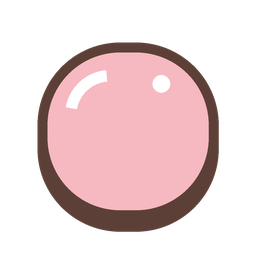
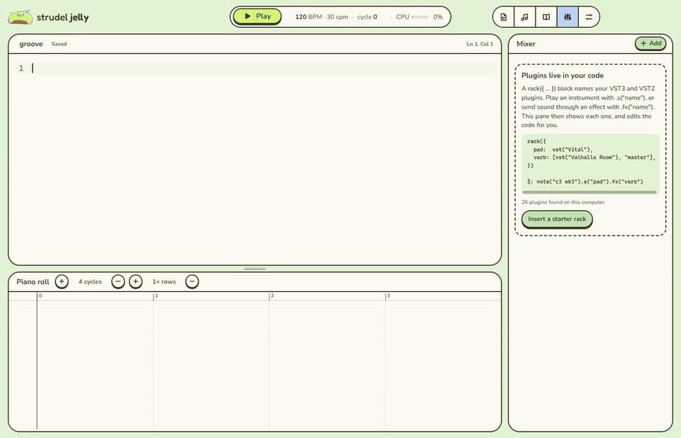

<div align="center">



# Strudel Jelly

**[Strudel](https://strudel.cc) live coding on your desktop, offline, with real VST3 and VST2 plugins.**


</div>



## Features

- **Hot reload.** The music updates as you type, and code that doesn't parse yet is skipped.
- **Plugins in code.** Play VST3 and VST2 synths with `.s()`, chain effects with `.fx()` and move knobs with `.set()`.
- **Old 32-bit plugins too.** 32-bit VST2 plugins run in their own bridge process, with their windows embedded as usual.
- **Mixer.** Reorder, bypass and add plugins in a pane that edits your code.
- **Piano roll.** Notes coloured by block. Click one to jump to the code that made it.
- **Built-in docs.** Every Strudel function with playable examples, on hover or `F1`.
- **Fully offline.** Every sound you load is cached, and you can save all built-in sounds at once.
- **Plain files.** Each sketch is a `.js` file and each folder of samples is a sound, all under `Documents\Strudel Jelly`.
- **Crash-safe audio.** Plugins run in a separate engine process, so a crashing plugin can't take the app down.

Plugins are found in the standard VST3 and VST2 folders, plus any you add in **Settings → Plugins**. A plugin installed as both VST3 and VST2 is loaded as VST3.

## Keys

| | |
| --- | --- |
| `Ctrl+Enter` / `Ctrl+.` | Play / stop |
| `Ctrl+K` | Search functions, sounds, sketches and commands |
| `Ctrl+N` / `Ctrl+S` | New sketch / save |
| `F1` | Docs for the function under the cursor |

Vim keys are in Settings.

## Build

Windows only. Needs Node.js, Visual Studio Build Tools (C++ workload), LLVM (clang-cl), CMake and Ninja.

```sh
npm install
npm run host:build   # the C++ audio engine (JUCE) and the 32-bit plugin bridge
npm run dev          # run the app
npm run dist         # package to release/win-unpacked/
```

`host:build` runs two CMake builds: the 64-bit `jelly-host.exe` and the 32-bit `jelly-bridge32.exe`, both copied to `host/bin/`.
The first build downloads JUCE and [FST](https://git.iem.at/zmoelnig/FST) (the VST2 headers), so it needs internet once.

## License

[AGPL-3.0-or-later](LICENSE), like Strudel. The audio engine uses [JUCE](https://juce.com) under the AGPL
and [FST](https://git.iem.at/zmoelnig/FST) (GPL-3.0-or-later) for VST2 support.

VST is a registered trademark of Steinberg Media Technologies GmbH.
